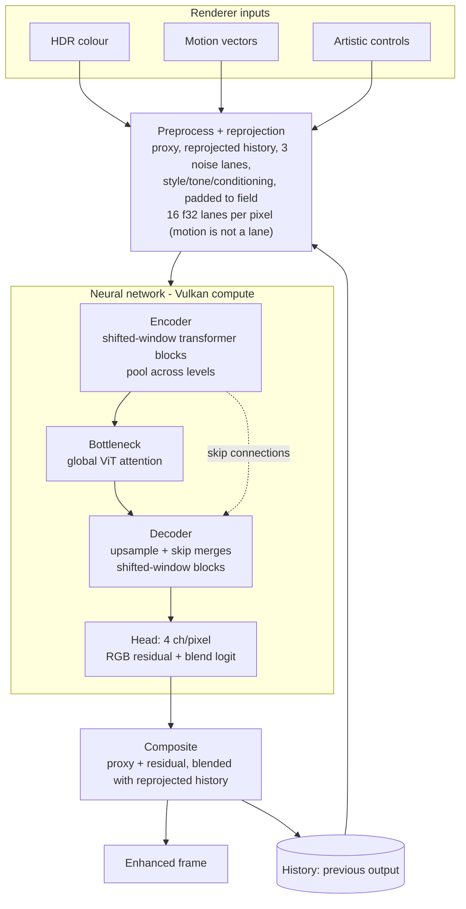
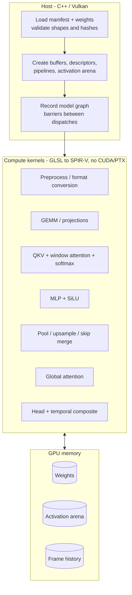

# Architecture

Same-resolution neural rendering (not upscaling). Model structure follows the OpenDLSS-NR documentation; the DLSS 5 report describes the concept only.

## 1. Frame pipeline

## 2. Implementation layers

## 3. Mapping to project tracks

| Piece | Track A (own kernels, synthetic weights) | Track B (external weights) | Track C (own small model) |
|---|---|---|---|
| Kernels in section 2 | implement and verify vs CPU | reuse | reuse |
| Weight loader | simple format | OpenDLSS-NR manifest | own format |
| Output quality | not evaluated | compare to reference | expected poor |

## Notes

- Precision: the reference uses FP8 E4M3 activations with FP16 accumulation and needs cooperative-matrix and float8 extensions. Portable FP16/FP32 kernels come first; FP8 is a stretch goal.
- A single-frame run is not the full temporal loop; history and reprojection must be implemented for temporal evaluation.
- Claim only what is tested: no cross-vendor support without running on other GPUs.
