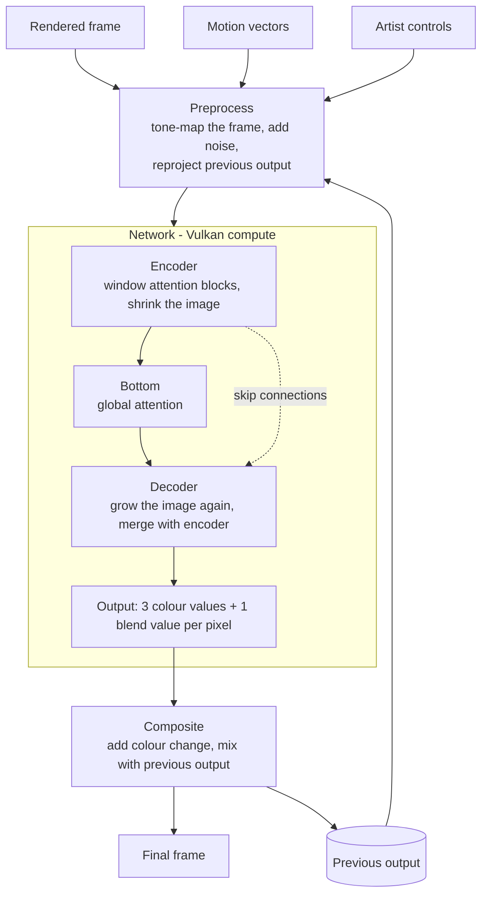
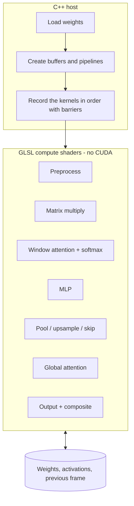

# Architecture

## What DLSS 5 is

DLSS 5 is not an upscaler like older DLSS. It runs after the game has drawn a frame and re-renders that frame so it
looks more photographic, while keeping the scene as the artists made it. The output has the same resolution as the
input.

What the NVIDIA report says, in short:

- One neural network pass per frame (a one-step diffusion model working directly on pixels).
- Inputs: the rendered frame, motion vectors, the previous output frame, and artist controls (style, structure and
  tone strength, masks).
- It only uses past frames, so it can run live in a game.
- The network is a transformer of about 154M parameters, using FP8 math on tensor cores.
- The report checks quality with a user study and image metrics (LPIPS, DINOv2).

OpenDLSS-NR is an open Vulkan version of this network. Its docs describe a concrete layout (71 blocks); I use it as a
guide for the structure, not as code to copy.

## 1. Frame pipeline

Motion vectors are only used to reproject the previous output; they are not an input of the network itself.

## 2. How I will build it

## 3. Weights

- My own kernels are tested with random weights against the CPU version.
- If allowed, I can load the OpenDLSS-NR weights and compare with the reference.
- If I train a small model myself, I can run it with the same kernels. Its image quality is expected to be poor.

